# 사이(SAI) 캠퍼스 내비게이션 — 아키텍처

서버 없는 **정적 SPA + BaaS(Supabase)** 구조입니다. 화면·3D 렌더링·길찾기·AR 위치 추정은 모두 브라우저에서 돌고,
공유가 필요한 데이터(제보·공사 정보·관리자 인증·사진)만 Supabase가 맡습니다.

```mermaid
flowchart TB
    %% ───────── 사용자 ─────────
    User(["👤 사용자<br/>PC 브라우저 · 휴대폰"])
    Admin(["🛠 관리자<br/>?edit=1"])

    %% ───────── 배포 ─────────
    subgraph Deploy["☁️ 배포 · GitHub"]
        direction LR
        Repo["GitHub 저장소<br/>main 브랜치 · PR"]
        GHA["GitHub Actions<br/>Node 24 · npm ci → npm test → npm run build"]
        Pages["GitHub Pages<br/>정적 호스팅 (dist/)"]
        Repo -->|push main| GHA -->|upload-pages-artifact · deploy-pages| Pages
    end

    %% ───────── 클라이언트 ─────────
    subgraph Client["🌐 브라우저 클라이언트 (Vanilla JS · ES Modules → esbuild IIFE 번들)"]
        direction TB

        subgraph Outdoor["캠퍼스 지도 페이지 · index.html → app.js"]
            direction TB
            UI["UI 계층<br/>app.js · sheet.mjs · search-suggestions.mjs<br/>HTML · CSS"]
            subgraph Map3D["3D 지도 (Three.js r180)"]
                direction LR
                Scene["map.js<br/>WebGLRenderer · MapControls<br/>CSS2DRenderer 라벨"]
                Bld["map/buildings<br/>건물 모델 16개 · 절차적 파사드 셰이더"]
                Land["map/landscape<br/>도로 · 나무 · 붕어방"]
                Extra["night-lighting · performance<br/>touch-gesture · keyboard-pan · navigation-bounds"]
            end
            subgraph Domain["도메인 로직 (순수 함수)"]
                direction LR
                Data["data.mjs · survey.mjs<br/>보행 그래프 · 출입구 병합"]
                Route["routing.mjs<br/>다익스트라 최단경로 · 막힘 우회"]
                Geo["geo.mjs · gis.mjs<br/>좌표 변환 · GeoJSON"]
                Guide["guidance.mjs · heading.mjs · gps-start.mjs<br/>턴바이턴 안내 · 방향 · 출발점 스냅"]
                Rep["reports.mjs · shortcuts.mjs<br/>길 막힘 · 지름길 제보"]
            end
            Backend["backend.mjs<br/>supabase-js 클라이언트"]
            Editor["editor.js (지연 로딩)<br/>그래프 편집 · 제보 승인"]
        end

        subgraph Indoor["미래관 실내 페이지 · indoor/index.html → indoor.js"]
            direction TB
            IView["view.js · model.mjs<br/>GLTFLoader (mirae.glb) · OrbitControls"]
            IRoute["route-search · route-places · guide<br/>층간 경로 · 실내 안내"]
            Lift["lift.js<br/>Web Speech 음성 안내"]
            subgraph AR["AR 길안내"]
                direction LR
                ARMain["ar.js · xr.js · calib.mjs<br/>WebXR immersive-ar · 카메라"]
                Worker["ar-worker.js (Web Worker)<br/>pf.mjs 입자 필터 · localize.mjs NCC 사진 매칭"]
                ARMain <-->|postMessage| Worker
            end
        end

        subgraph BrowserAPI["브라우저 API"]
            direction LR
            GPS["Geolocation"]
            Orient["DeviceOrientation"]
            Cam["getUserMedia · WebXR"]
            Misc["Wake Lock · Vibration<br/>Web Share · Clipboard"]
            Store["localStorage · sessionStorage"]
        end
    end

    %% ───────── 정적 데이터 ─────────
    subgraph Static["📦 정적 데이터 (dist/data · dist/indoor)"]
        direction LR
        Campus["seoultech.json / .geojson<br/>OSM 기반 · ODbL"]
        Survey["team-survey.json<br/>현장 조사 출입구·관통로"]
        Mirae["mirae.glb · mirae.json<br/>entrances.json"]
        ARIdx["ar-index.bin · sv.json<br/>촬영 프레임 기준 데이터"]
    end

    %% ───────── 백엔드 ─────────
    subgraph Supa["🟩 Supabase (BaaS)"]
        direction LR
        Auth["Auth<br/>이메일 로그인 · app_metadata.role=admin"]
        PG[("PostgreSQL + RLS<br/>road_reports · building_works<br/>shortcut_reports")]
        Bucket[("Storage<br/>report-photos 버킷")]
        Mig["supabase/migrations<br/>Supabase CLI"]
        Mig -.->|스키마 · 정책| PG
    end

    %% ───────── 개발 도구 ─────────
    subgraph DevTools["🧰 개발 · 데이터 파이프라인"]
        direction LR
        Dev["scripts/dev.mjs<br/>esbuild watch·serve<br/>--phone: OpenSSL 자체서명 HTTPS"]
        Build["scripts/build.mjs<br/>esbuild 번들·minify"]
        Test["node:test<br/>tests/*.test.mjs"]
        Fmt["Prettier"]
        Py["Python 스크립트<br/>Shapely · NumPy · OpenCV"]
    end

    %% ───────── 흐름 ─────────
    User -->|HTTPS| Pages
    Admin -->|HTTPS| Pages
    Pages --> Outdoor
    Pages --> Indoor
    Pages --> Static

    UI --> Scene
    UI --> Domain
    UI --> Backend
    Scene --> Bld & Land & Extra
    Data --> Route
    Route --> Guide
    Geo --> Data
    UI -.->|"?edit=1"| Editor
    Editor --> Backend
    UI -->|"실내 진입"| Indoor

    IView --> IRoute --> Lift
    IRoute --> ARMain

    Guide --> GPS & Orient
    ARMain --> Cam & Orient & Misc
    Backend --> Store

    Data -->|fetch| Campus & Survey
    IView -->|fetch| Mirae
    Worker -->|fetch| ARIdx

    Backend -->|"supabase-js · REST"| Auth
    Backend -->|"CRUD (RLS 보호)"| PG
    Rep --> Backend
    Backend -->|사진 업로드 · 정리| Bucket

    Py -->|생성| Campus & Mirae & ARIdx
    Build -->|dist/| Repo
    Test -.-> GHA

    classDef ext fill:#e8f5e9,stroke:#2e7d32,color:#1b5e20
    classDef deploy fill:#e3f2fd,stroke:#1565c0,color:#0d47a1
    classDef data fill:#fff8e1,stroke:#f9a825,color:#6d4c00
    class Auth,PG,Bucket,Mig ext
    class Repo,GHA,Pages deploy
    class Campus,Survey,Mirae,ARIdx data
```

## 기술 스택 요약

| 계층 | 기술 |
| --- | --- |
| 언어 · 모듈 | JavaScript (ES2020, ES Modules `.mjs`), HTML, CSS, Python |
| 3D 렌더링 | Three.js r180 — WebGLRenderer, MapControls/OrbitControls, CSS2DRenderer, GLTFLoader, BufferGeometryUtils, 커스텀 셰이더 |
| 길찾기 | 보행 그래프 + 다익스트라 최단경로, 막힘 우회, 건물 관통 간선, GPS 출발점 스냅 |
| AR | WebXR `immersive-ar`, getUserMedia 카메라, Web Worker, 입자 필터(PF) + 원통 띠 NCC 사진 재위치 |
| 브라우저 API | Geolocation, DeviceOrientation, Web Speech, Wake Lock, Vibration, Web Share, Clipboard, localStorage/sessionStorage |
| 백엔드 (BaaS) | Supabase — Auth(관리자 역할), PostgreSQL + RLS, Storage(`report-photos`), CLI 마이그레이션 · `@supabase/supabase-js` v2 |
| 빌드 · 개발 | esbuild(번들·minify·watch·serve), OpenSSL 자체서명 HTTPS(휴대폰 테스트), Prettier |
| 테스트 | Node.js 내장 테스트 러너 `node:test` |
| 데이터 준비 | Python — Shapely(그래프·출입구 정리), NumPy, OpenCV(AR 기준 데이터) |
| 데이터 | OSM 기반 캠퍼스 데이터(ODbL), 팀 현장 조사 GeoJSON, 미래관 GLB 모델 |
| CI/CD · 호스팅 | GitHub Actions(Node 24, 테스트 → 빌드) → GitHub Pages |
